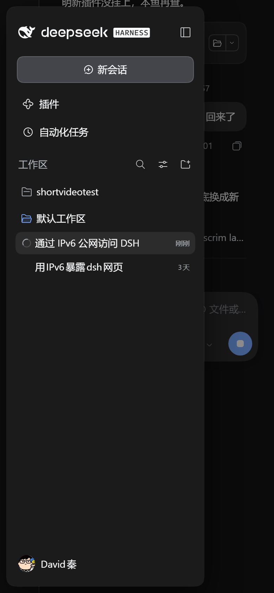
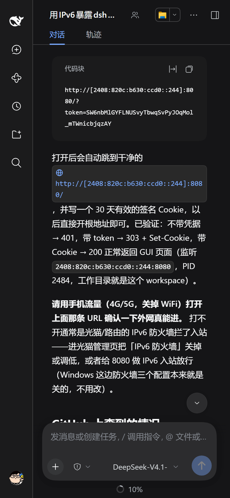
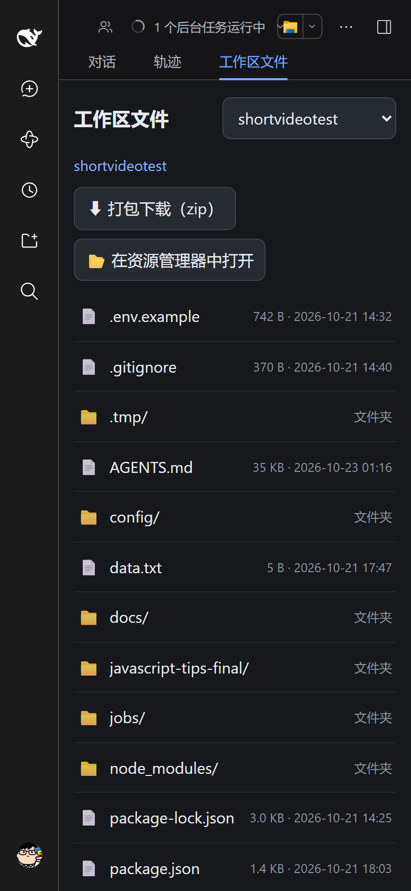

# dsh-mobile-shell

把 DeepSeek Harness 的 Web GUI 在**手机**上真正用起来：悬浮式侧栏、页面锁死只滚对话、
点输入框不放大、切会话不抢焦点、键盘弹出时输入框贴着键盘上移，并给非安全上下文补上
`crypto.randomUUID`。顺带还有一个**工作区文件浏览器**：在手机浏览器里浏览工作区、
下载任意文件、在宿主机的资源管理器里打开当前文件夹。

*English*: A mobile shell layer for the DeepSeek Harness Web GUI — drawer overlay,
page lock, no iOS focus zoom, keyboard-aware composer, the
`crypto.randomUUID` polyfill that plain-HTTP (non-secure context) browsing needs,
plus a cookie-authenticated workspace file browser with download and
"reveal in file manager".




---

## 为什么需要它

DSH 的 Web GUI 是按桌面设计的：打包后的前端 CSS 里**没有任何宽度 media query**。
在手机上（尤其是通过公网 IPv6 + 明文 HTTP 打开时）会遇到这些问题：

| 问题 | 原因 | 本插件的做法 |
|---|---|---|
| 前端 RPC 全失败、会话列表空白 | 浏览器只在安全上下文（HTTPS / localhost）暴露 `crypto.randomUUID`，明文 HTTP 下没有 | 注入标准 UUID v4 polyfill（`crypto.getRandomValues`） |
| 侧栏展开把对话挤成一条缝 | 外壳是 CSS grid，列宽写在内联样式里，且 grid item 有 `overflow: hidden` | 固化列宽，侧栏改为**覆盖式悬浮卡片** + 遮罩，点外面收起 |
| 上下滑动时整页跟着动 | iOS 页面级回弹 / 地址栏收起；插件统计行还把滚动容器横向撑宽 30px | `html/body` 钉成视口、页面不可滚，只有对话滚动；隐藏统计行 |
| 点输入框整页被放大 | 输入框是 `contenteditable` 的 div，字号 14px（< 16px 即触发 iOS 聚焦缩放） | 强制 16px、改写 `meta viewport`、拦 `gesturestart` |
| 切会话自动弹键盘 | 会话视图挂载时会 `focus()` 输入框 | 只保留「用户自己点进去」的聚焦，其余立刻 `blur()` |
| 键盘挡住输入框 | iOS 不为软键盘缩小布局视口 | 用 `visualViewport` 算键盘 inset，对话列整体上移 |

另外：切会话时抽屉自动收起、设置弹窗改为全屏 + 顶部分组横滑、触控目标 ≥ 32px。

## 工作区文件浏览器

对话区顶部原本是「对话 / 轨迹」两个标签，插件在它们后面追加了第三个：
**工作区文件**。点它会在对话区里内嵌打开文件浏览页（iframe），点「对话 / 轨迹」就切回去。



也可以绕过标签直接访问 `http://<你的地址>/api/workspace-files`。

页面会**跟随 DSH 的主题**：它被 GUI 以 iframe 嵌在同一个源里，所以直接读父页面的
`body[data-ds-dark-theme]` 标记切换深/浅配色（独立打开时退回系统偏好），每秒同步一次，
你在界面里换主题它也会跟着换。页面骨架本身的模板在 `assets/files-page.html`，和
`mobile-fix.css` / `shell.js` 一样**每次请求读盘**，改样式只需刷新。

| 路由 | 作用 |
|---|---|
| `GET /api/workspace-files` | 网页版文件浏览：工作区切换、面包屑、目录列表（文件夹优先，显示大小/时间） |
| `GET /api/workspace-files.download?w=&p=` | 以附件下载文件（`content-disposition`，中文名走 `filename*=UTF-8''`） |
| `GET /api/workspace-files.zip?w=&p=` | 把当前文件夹**流式打包成 zip**（无依赖实现：`zlib` + 自写 ZIP 容器；文本走 DEFLATE，>64 MB 的媒体走 STORE） |
| `POST /api/workspace-files.open?w=&p=` | 在**宿主机**的资源管理器 / Finder 里打开该文件夹 |

`w` 是工作区序号（页面下拉框里的顺序），`p` 是相对工作区根的路径。

zip 的边界（都是明确的报错，不会吐半截坏包）：条目数 ≤ 20000、总大小 ≤ 3.5 GiB、不支持
ZIP64；打包前先扫描，超限直接 `413`。实测 8.7 MB / 177 个文件的目录耗时约 0.5 秒，用
Windows 自带解压器解开后文本逐字节一致、PNG 完好。

安全设计：

- 三个路由都注册在 Connection 的 `/api` 传输上，**自动继承同一套 cookie 鉴权与
  Host/Origin 栅栏**——没有会话 cookie 一律 401，伪造 Host 403；
- 每次请求都用 `realpath` 解析并校验「仍在工作区根内」，`..`、符号链接、跨盘符都会被拒；
- 页面标题/文件名全部 HTML 转义，目录列表上限 2000 条；
- `open` 只启动宿主机上的 `explorer.exe` / `open` / `xdg-open`，不做任何 shell 拼接。

所以它的暴露面和 GUI 本身一致：**能登录 GUI 的人，本来就能让 agent 读这些文件**。

## 安装

插件就是一个普通的 DSH bundle（`dsh.bundle.patch` → `cordis.patch.yml`），不修改 DSH 本体。

```sh
# 从本地目录
dsh plugin --profile web add file:/path/to/dsh-mobile-shell

# 或从 Git
dsh plugin --profile web add git+https://github.com/mengqinlol/dsh-mobile-shell.git

# 开发时用 link:，profile 直接跑源码
dsh plugin --profile web add link:/path/to/dsh-mobile-shell
```

安装后重启 DSH 服务；之后打开 Web GUI 即生效（没有配置项）。

> 只针对窄屏（`max-width: 820px`）生效，桌面端观感不变。建议配合 HTTPS 使用；
> 明文 HTTP 下插件只是「让界面能用」，并不会加密流量。

## 结构

```
dsh-mobile-shell/
├── package.json             # dsh.bundle.patch → cordis.patch.yml
├── cordis.patch.yml         # 只插入自己这一行，不动任何其它行
├── lib/index.js             # index tap：polyfill + <style> + <script>；挂载文件路由
├── lib/workspace-files.js   # /api/workspace-files(.download|.zip|.open) 四个路由
├── lib/zip.js               # 无依赖流式 ZIP 写入（CRC32 + zlib DEFLATE + central directory）
├── assets/files-page.html   # 文件浏览页模板（每次请求读盘）
├── assets/mobile-fix.css    # 移动端样式（每次请求读盘）
├── assets/shell.js          # 移动端行为 + 抽屉里的「工作区文件」入口（每次请求读盘）
└── test/smoke.mjs           # 挂载插件，断言注入内容 + 文件路由/zip/越权拦截
```

`lib/index.js` 通过 webserver 的 `tapIndex` 钩子改写 `index.html`；两个资源文件在**每次
请求时读盘**，所以改样式/前端行为只需刷新页面，不必重启服务。改 `lib/*.js`（路由、注入
逻辑）需要重启（Node 的 ESM 模块缓存）。

## 兼容性

- 在 DSH `0.2.1-rc.2`（Windows / Electron）上实测。
- 选择器优先用 DSH 的稳定属性（`data-slot` / `data-composer-card` / `role="dialog"`），
  再用 `:has()` 做结构定位；个别 hash 类名（`BynINW_*`、`Dc7zOa_*`）作为兜底。
  DSH 更新后若布局变化，最坏情况是某条修饰失效，不会让页面打不开。
- 不绑定端口、不改 webserver 行：绑定地址始终由 `dsh web --host/--port` 决定。

## 开发

```sh
npm test        # 无需依赖：挂载插件 + 断言注入内容
```

## 许可

MIT。`crypto.randomUUID` polyfill 的思路与实现源自
[dsh-lan-access](https://github.com/Leon0555/dsh-lan-access)（MIT © Leon0555），其余为本项目实现。
